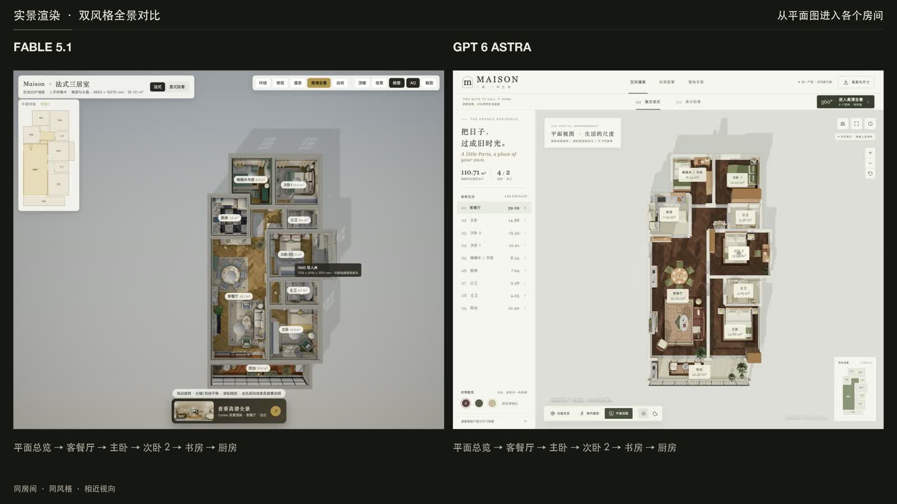
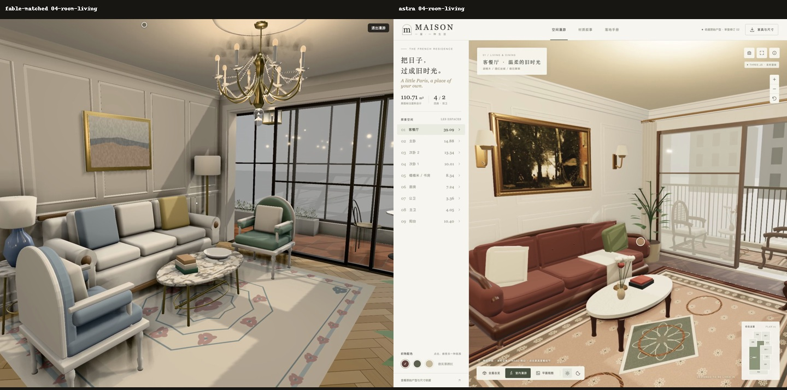
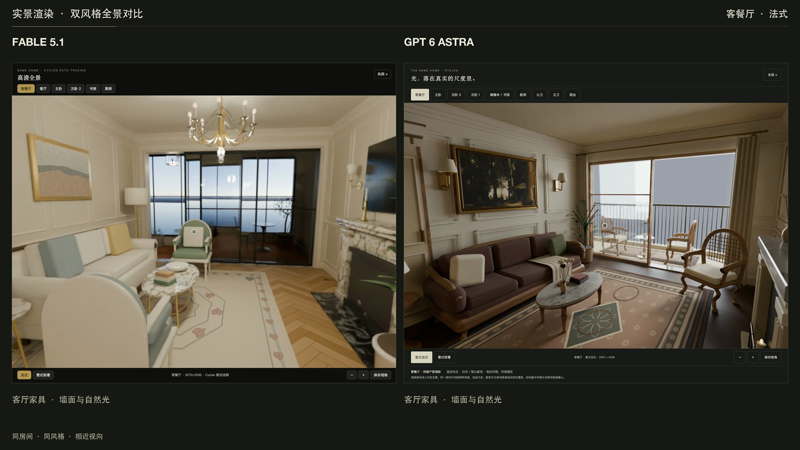
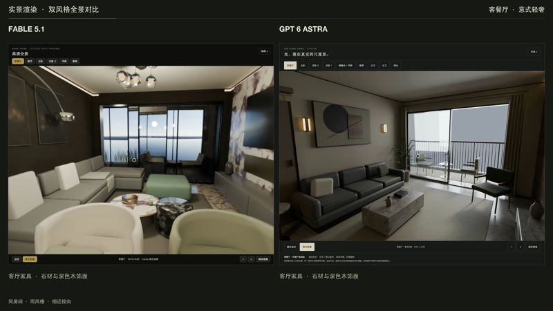

# House 3D · GPT6 与 Fable 效果对比

这个仓库收录 **GPT6** 和 **Fable** 分别生成的 3D 家装项目，用于直观对比两个模型在户型理解、空间建模、家具细节、材质灯光、界面交互和工程实现上的效果。

两套项目围绕同一张住宅户型图，均提供「复古法式」与「意式轻奢」方案，并支持实时三维与 Blender Cycles 离线渲染全景。打开相同房间、切到相同风格，就可以观察两种实现的差异，也可以直接阅读源码和资产生成脚本。

**`gpt6/` 是 GPT6 版本，`fable/` 是 Fable 版本。** 模型名称按维护者提供的标签记录。这里展示的是经过对话和后续迭代形成的项目快照；仓库未收录完整生成对话、原始提示词、采样参数、耗时或费用记录，也未控制依赖版本与实现方式，因此不能据此给出严格的模型排名。

## 在线体验

| 版本 | 法式 | 意式轻奢 | 源码与说明 |
| --- | --- | --- | --- |
| GPT6 | [打开法式方案](https://www.lyx666.cn/housegpt/?style=french) | [打开意式方案](https://www.lyx666.cn/housegpt/?style=italian) | [gpt6/](gpt6/) |
| Fable | [打开法式方案](https://www.lyx666.cn/maison/?style=french) | [打开意式方案](https://www.lyx666.cn/maison/?style=italian) | [fable/](fable/) |

在线演示由维护者独立部署，后续可能更新；要复现本仓库的特定版本，请检出对应 Git 提交后在本地运行。

## 对比视频与图片

两段视频均为 **3 分钟、3200 × 1800、30 fps**，左侧为 **Fable 5.1**，右侧为 **GPT 6 Astra**。点击封面打开 MP4 文件；也可以下载后播放。

| 实景对比：平面图开场、双风格全景与新配乐 | 交互对比：全屋、漫游、家具与触屏 |
| --- | --- |
| [](media/videos/house-realistic-comparison-plan-music.mp4) | [](media/videos/house-comparison.mp4) |
| [播放 / 下载实景版 MP4（76.7 MiB）](media/videos/house-realistic-comparison-plan-music.mp4) | [播放 / 下载交互版 MP4（84.8 MiB）](media/videos/house-comparison.mp4) |

**法式客餐厅**



**意式轻奢客餐厅**



这些成片与预览图来自「了解视频制作能力」任务，展示不同迭代阶段的录制结果。实景版按同房间、同风格和相近视向配对，两个项目的固定全景机位并不完全相同。录制早于本次 Fable 0.3.3 同步，画面中的「三居室」「书房」等旧文案保留；视频不代表当前提交的页面验收。文件清单、章节、配乐来源与校验值见 [媒体说明](media/README.md)。

## 本地运行

需要 **Node.js 20.19+（20.x）或 22.12+**，建议使用 Node.js 24；使用 npm 和支持 WebGL 2 的现代浏览器。两个项目均为纯前端，运行时不调用模型 API，不需要 API Key、后端服务或数据库。预生成的 GLB 与全景 JPG 已包含在仓库内，运行页面无需安装 Blender。

```bash
git clone https://github.com/hahaliu1029/house-3d.git
cd house-3d
```

在两个终端分别执行：

```bash
# 终端 1：GPT6
cd gpt6
npm ci
npm run dev -- --port 5173 --strictPort
# 打开 http://127.0.0.1:5173/housegpt/
```

```bash
# 终端 2：Fable（从仓库根目录开始）
cd fable
npm ci
npm run dev -- --host 127.0.0.1
# 打开 http://127.0.0.1:5174/maison/
```

保留了两个项目原有的 URL 前缀 `/housegpt/` 和 `/maison/`；目录名与访问路径不同。需要指定风格时，在 URL 后添加 `?style=french` 或 `?style=italian`。首次安装依赖需要网络；两套家装场景的模型、纹理和全景均由本地提供。GPT6 保留了 World Labs 研究用查看器源码，最新主页面已移除其入口且不打包 Spark；若自行接入，该源码按需读取官方 CDN，需要联网。第三方图书馆样例未随仓库分发，也不是当前户型的生成结果。

## 如何对比

1. 使用同一台设备、同一个浏览器和相近窗口尺寸，分别打开两个版本。
2. 选择同一风格、同一房间、同一昼夜状态，并尽量对齐观察位置与视角。
3. 观察户型还原、家具比例、材质与灯光、空间通行、风格一致性以及交互体验。
4. 查看对应代码、几何测试和设计说明，区分视觉观感与程序检查结果。

比较高清效果时，两边都进入全景模式；比较漫游与交互时，两边都使用实时三维。全景只能在固定机位环顾、缩放和跳转，不能当作可自由移动的实时渲染。

| 项目 | GPT6 | Fable |
| --- | --- | --- |
| 原项目目录名 | `housegpt` | `house` |
| 主要实现 | Three.js 程序化建筑与家具、CC0 PBR 材质，独立 Blender 吊灯 | Three.js 建筑与程序化纹理，Blender 家具资产 |
| 随仓库提供的 GLB | 2 个吊灯模型 | 121 个家具、灯具及设施模型 |
| Cycles 全景 | 9 个房间 × 2 种风格；8K 桌面、4K 手机及预览，共 54 张 JPG | 7 个视点 × 2 种风格；3072 × 1536 全景及预览，共 28 张 JPG |
| Three.js / Vite（锁文件） | 0.180.0 / 7.3.6 | 0.185.1 / 8.2.2 |
| 交互 | 房间跳转、室内移动、风格/昼夜/配色切换、家具查看、PNG/CSV/手册导出 | 轨道/俯视/漫游、风格/昼夜切换、天花板/标签开关、家具查看、截图 |
| 设计资料 | [建筑假设](gpt6/docs/architecture-assumptions.md)、[法式手册](gpt6/docs/复古法式-落地手册.md)、[意式手册](gpt6/docs/意式轻奢-落地手册.md) | [设计与复刻手册](fable/docs/design-spec.md) |

这里的版本、功能和资产数量描述代码现状，不构成质量评分。两套测试覆盖的内容也不同，不能用通过项数判断哪个模型更好。

## 检查与构建

在已安装依赖的 `gpt6/` 或 `fable/` 目录下运行：

```bash
npm test
npm run build
npm run preview
```

每个版本分别输出自己的 `dist/`。预览时在终端给出的地址后使用对应的 `/housegpt/` 或 `/maison/` 前缀。静态部署说明见 [GPT6 部署说明](gpt6/docs/deployment.md) 和 [Fable README](fable/README.md)。资产再生成命令在各自 README 中。

## 仓库结构

```text
gpt6/                  GPT6 版本：源码、模型、测试与设计文档
fable/                 Fable 版本：源码、模型、测试与 Blender 脚本
media/                 对比成片、预览图片、来源与校验清单
docs/publication.md    开源整理范围与验证记录
LICENSE                Apache License 2.0 许可证
NOTICE                 项目版权与第三方声明索引
THIRD_PARTY_NOTICES.md  依赖、素材来源与授权范围
CONTRIBUTING.md         贡献与对比结果反馈方式
SECURITY.md             安全问题反馈方式
```

两套实现独立保留，不共享依赖或场景代码。首次开源整理未改动场景源码、模型和几何测试；整理范围见 [发布记录](docs/publication.md)。

2026-09-06 已同步两版全景、渲染脚本与交互更新，随后同步 Fable 0.3.3 的四卧室全景映射和次卧 1 资产，并收录对比视频与图片；详见 [发布记录](docs/publication.md)。

## 授权与使用范围

本仓库自有代码、文档和程序化生成资产采用 [Apache License 2.0](LICENSE)。第三方依赖、公共领域油画及输入户型图分别按 [素材与授权说明](THIRD_PARTY_NOTICES.md) 处理；输入参考图不包含在 Apache-2.0 授权范围内。

项目用于模型效果比较、学习与家装方案展示。房屋尺寸、结构和家具净距含推导与假设，不能直接作为施工、采购或结构安全依据。模型标签与项目中的产品名称不表示官方合作或品牌授权。

欢迎通过 [Issues](https://github.com/hahaliu1029/house-3d/issues) 提交可复现问题和对比观察，或按 [贡献指南](CONTRIBUTING.md) 提交改进。
